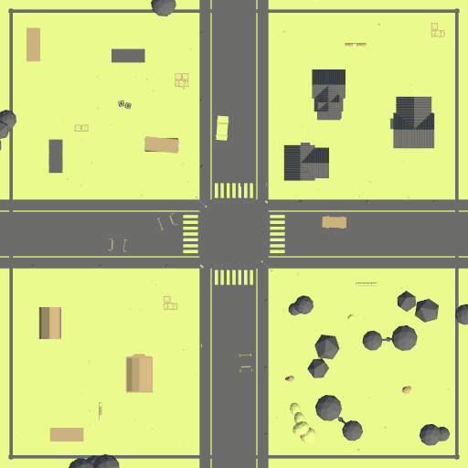
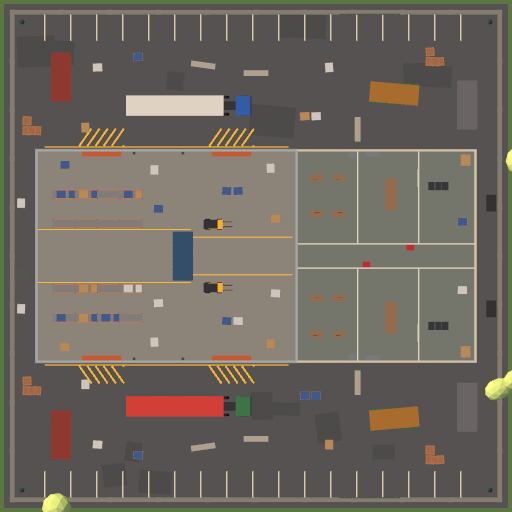

# Airsoft

Multiplayerová FPS ze světa airsoftu pro až 8 hráčů. Školní projekt DPM (Denis Řezníček).
Unity 6.6 (URP), Netcode for GameObjects, Unity Relay.

- **Stáhnout hru (v0.2.1, macOS a Windows):** <https://rezdenssps.itch.io/airsoft>
- **Repozitář:** <https://github.com/rezdenSSPS/arbes>
- **Vývojový deník:** [DEVLOG.md](DEVLOG.md)
- **Build a vydání:** [docs/BUILD.md](docs/BUILD.md)
- **Návrh UI (Claude Design canvas):** <https://claude.ai/artifact/H16xM5KTXvKWrjhFWzd41d>

## O hře

Hráči se utkají na dvou low-poly mapách s replikami airsoftových zbraní (GBB pistole, AEG, pružinové pušky).
Místo okamžitého zásahu (hitscan) létají skutečné kuličky (BB) s úsťovou rychlostí, gravitací, hop-upem a odporem
vzduchu. Zásahy ověřuje server. Hra má 10 režimů: kooperaci proti AI, klasický deathmatch, airsoftový Milsim
(„jeden zásah = HIT“, dojdi zpět na základnu) i objektivové režimy (vlajky, body, bomba, VIP, medik).

V lobby je editor postavy (tělo, čepice, brýle/maska, barvy), hlasování o mapě, boti do volných míst a lokální
profil se statistikami, XP a odemykáním vzhledu. **Texty ve hře jsou anglicky.**

## Mapy

| Town | Warehouse |
|---|---|
|  |  |
| 80 × 80 m: křižovatka, domy, park, kontejnerový sklad. Scéna `AirsoftArena`. | 60 × 60 m, boj na krátkou vzdálenost: hala s regály, kanceláře, nakládací dvory. Scéna `AirsoftWarehouse`. |

Obrázky jsou náhledy map shora, které editor vykresluje pro hlasování v lobby (`Assets/Resources/MapPreviews`).
Obě mapy mají body pro všechny režimy. Červení začínají na severu, Modří na jihu.

## Jak hrát

### Instalace
Hru stáhneš z [itch.io](https://rezdenssps.itch.io/airsoft), nejpohodlněji přes aplikaci [itch](https://itch.io/app).
Build není podepsaný: na Windows může SmartScreen hlásit neznámého vydavatele, na macOS je potřeba povolit spuštění
(postup je v [docs/BUILD.md](docs/BUILD.md), část *5. Pro hráče*).

### Online (kódem)
1. Hostitel: záložka **ONLINE** → **HOST GAME**. Hra se přihlásí ke službám Unity a založí místnost přes Unity Relay.
2. V lobby se ukáže **JOIN CODE** (kliknutím se zkopíruje). Pošli ho ostatním.
3. Ostatní: **ONLINE** → vložit kód do **JOIN CODE** → **JOIN**.

Potřebuje internet, port-forwarding není potřeba.

### LAN
1. Hostitel: záložka **LAN** → **HOST ON LAN** (UDP port 7777).
2. Ostatní: **LAN** → do **HOST IP ADDRESS** napsat IP adresu hostitele → **JOIN**. Na stejném počítači `127.0.0.1`.

Pokud se nikdo nepřipojí, může hostitele blokovat firewall (povol hru, případně UDP port 7777). Když port 7777
už používá jiná spuštěná hra na stejném počítači, hostování skončí chybou s možností to zkusit znovu.

### Lobby
- Hostitel vybírá režim (karty, nebo klávesa **M**), časový limit (Off / 5 / 10 / 15 min), boty a obtížnost botů.
- Každý hráč si nastaví jméno (callsign), postavu (**CUSTOMIZE**), hlasuje o mapě a dá **READY UP** (klávesa **R**).
- Hostitel spustí zápas tlačítkem **START MATCH**. Karta režimu, pro který mapa nemá potřebné body, je zašedlá.

## Ovládání

| Akce | Klávesa |
|---|---|
| Pohyb | W A S D |
| Sprint | Shift (omezený výdrží – ukazatel u zdraví) |
| Náklon (lean) | Q / E (držet) |
| Přikrčení | C / Ctrl (v nastavení přepnutí nebo držení) |
| Skok | Space |
| Střelba | levé tlačítko myši |
| Míření / puškohled | pravé tlačítko myši |
| Bang (eliminace na blízko bez výstřelu) | V |
| Kouřový granát (gadget, vestoje) | G |
| Přebití | R |
| Zbraně | 1 – 0, kolečko myši |
| Scoreboard | Tab (držet) |
| Interakce | E (držet): položit / zneškodnit bombu, evakuace VIP, oživení medikem |
| Vzdát se (Medic, když jsi dole) | G (držet) |
| Další spoluhráč při sledování (Bomb) | levé tlačítko myši / Space |
| Pauza, nastavení | Esc |
| Lobby: ready / změna režimu (host) | R / M |

Nastavení (*Settings*): citlivost myši a v puškohledu, invertovaná osa Y, FOV, rozlišení, celá obrazovka, V-Sync,
kvalita, post-processing, barva a velikost zaměřovače, ukazatele zdraví nad hlavami, killcam, minimapa. Ukládá se do PlayerPrefs.

## Herní režimy

| Režim | Typ | Cíl | Boti |
|---|---|---|---|
| Co-op Survival | spolupráce | přežít vlny AI nepřátel (bez časového limitu) | – |
| Free-for-All | každý sám | 15 killů | ano |
| Team Deathmatch | Red vs Blue | 40 killů týmu | ano |
| Gun Game | každý sám | každý kill = další zbraň, projít všech 10 | ano |
| Milsim | Red vs Blue | zásah = HIT, zasažený dojde na základnu; 30 zásahů | ano |
| Capture the Flag | Red vs Blue | 3 doručení vlajky | ne |
| Domination | Red vs Blue | držet body A, B, C; 200 bodů | ne |
| Medic | Red vs Blue | HIT = hráč padne, medik ho oživí; 25 tiketů pro tým 4 hráčů | ne |
| Bomb | Red vs Blue, kola | položit bombu na A/B nebo ji zneškodnit, v kole bez respawnu; 4 kola | ne |
| VIP Escort | Red vs Blue, kola | dovést VIP k evakuaci, nebo ho vyřadit; 3 kola | ne |

Časový limit z lobby platí ve všech režimech kromě Co-op, Bomb a VIP Escort (ty mají časovaná kola). Po vypršení
vyhrává lepší skóre, při přesné shodě je remíza. V týmových režimech je vypnutý friendly fire. Po spawnu mají
hráči 3 s ochranu, která skončí prvním výstřelem.

## Zbraně

Pořadí slotů (klávesy 1–0) je zároveň pořadí v Gun Game:
1911 GBB pistole, CO2 revolver, Uzi GBB, P90 AEG, pružinová brokovnice M870 (3 kuličky na výstřel), AK AEG,
RPK podpůrná AEG, M14 DMR, pružinová opakovačka, L96 pružinová odstřelovačka.
Statistiky jsou v `Assets/Scripts/FPS/WeaponData.cs`.

## Pro vývojáře

### Otevření projektu v Unity
1. Nainstaluj **Unity 6000.6.0f1** (Unity 6.6) přes Unity Hub. Pro build na druhou platformu přidej modul
   *Mac Build Support (Mono)* nebo *Windows Build Support (Mono)*.
2. Naklonuj repozitář:
   ```bash
   git clone https://github.com/rezdenSSPS/arbes.git
   ```
3. Unity Hub → **Add → Add project from disk** → složka `arbes`. První import trvá déle; skript `AirsoftAssetSetup`
   navíc jednou přeimportuje modely Quaternius s nastavením projektu.
4. **Play** spustí vždy scénu `AirsoftLobby`, ať je otevřená jakákoli scéna (nastavuje to `AirsoftSceneBuilder`).
5. Multiplayer v editoru: balíček Multiplayer Play Mode. Virtuální hráč se sám připojí na `127.0.0.1:7777`.
   Hlavní editor buď hostuje ručně (LAN → HOST ON LAN), nebo se zapnutým *Tools → Airsoft → MPPM Auto-Connect
   (loopback)* hostuje sám a rovnou načte arénu.
6. Online (Relay) používá Unity Gaming Services projekt propojený v *Edit → Project Settings → Services*.

### Přegenerování scén (menu Tools → Airsoft)
Scény a prefaby nejsou ručně skládané, staví je editorové skripty v `Assets/Editor`. Přegenerování přepíše
dotčené scény, takže ruční úpravy v nich se ztratí.

| Položka menu | Co dělá |
|---|---|
| Rebuild All Scenes | `AirsoftSceneBuilder`: materiály, prefaby `FPSPlayer` a `Enemy`, scény `AirsoftLobby` a `AirsoftArena` (Town), build settings (ostatní mapy v seznamu nechá). Spustí se samo, když lobby nebo aréna chybí. |
| Rebuild Arena Only | jen mapa Town: prostředí (`AirsoftMapBuilder`), herní objekty a body režimů (`ObjectiveMapSetup`) |
| Rebuild UI Only | vymění UI objekty v lobby a Town za UI generované za běhu, mapu nechá |
| Update Arena Spawn Points | přepíše jen spawny v Town podle tabulek v `AirsoftSceneBuilder` |
| Check Spawn Points | report: umístění spawnů, silnice, z jak velké části mapy je bod vidět |
| Update Arena Map Layout (objective points) | `ObjectiveMapSetup`: body režimů na Town (základny, A/B/C, místa bomby, VIP) |
| Build Warehouse Map | `AirsoftWarehouseBuilder`: celá scéna `AirsoftWarehouse` včetně NavMeshe, přidá ji do build settings |
| Render Map Previews | náhledy map pro lobby do `Assets/Resources/MapPreviews` |
| Fix Network Prefab IDs | zapíše síťová ID prefabů `FPSPlayer` a `Enemy` (potom restartuj virtuální hráče MPPM) |
| Reimport Quaternius Assets | znovu importuje modely Quaternius |
| Check Objective Rules / Check Medic Rules | kontrola pravidel režimů bez sítě |
| Play Check: CTF / Domination / Bomb / VIP Escort / Medic | kontrola režimu v play módu (jen host) |
| MPPM Auto-Connect (loopback) | přepínač automatického hostování pro testy s MPPM |

`Assets/Resources/MapManifest.asset` (které režimy mapa umí) se obnoví při každém uložení scény s `MapLayout`.
Po přegenerování lobby zkontroluj, že `NetworkManager` v `AirsoftLobby` odkazuje na
`Assets/DefaultNetworkPrefabs.asset`. Bez toho host funguje, ale klienti se nespawnou (viz DEVLOG, opravy 2026-10-22).

Některé kroky jdou spustit i bez otevřeného editoru (batch mode), např.:
```bash
/Applications/Unity/Hub/Editor/6000.6.0f1/Unity.app/Contents/MacOS/Unity -batchmode -quit -projectPath "$PWD" -executeMethod AirsoftFPS.Editor.AirsoftWarehouseBuilder.BuildWarehouse
```
Další metody: `AirsoftFPS.Editor.AirsoftWarehouseBuilder.RenderMapPreviews` (v batch mode jako samostatný druhý krok)
a `AirsoftFPS.Editor.ObjectiveMapSetup.UpdateArenaLayout`.

Nová mapa potřebuje: scénu v build settings, záznam v `MapCatalog.Maps`, komponentu `MapLayout` s body režimů,
`SpawnPoint`y a náhled v `Resources/MapPreviews`.

### Build a vydání
Podrobně v [docs/BUILD.md](docs/BUILD.md). Jsou dvě cesty:
- **Lokálně** v Unity (batch mode) a nahrání na itch.io nástrojem **butler**. Takhle vznikla vydání v0.2.0 a v0.2.1.
- **GitHub Actions** (`.github/workflows/build.yml`, GameCI): připravené, ale zatím nespuštěné, chybí secrety s Unity licencí.

### Struktura projektu
```
Assets/
  Scripts/FPS/               herní kód (namespace AirsoftFPS)
    MatchNet*.cs             stav zápasu a lobby, režimy, skóre, boti (MatchNet.Bots), hlasování o mapě (MatchNetMapVote)
    NetworkUI*.cs            menu, připojování, lobby (+ MapVote, Medic)
    FPSController.cs         pohyb hráče
    WeaponController.cs      střelba, přebíjení, serverové ověření zásahů
    WeaponData.cs            statistiky 10 zbraní
    BBBallistics.cs          let kuliček (sdílený klient/server), BBProjectile.cs = viditelná kulička
    Health.cs                zdraví, HIT, respawn, ochrana po spawnu
    PlayerSpawner.cs         výběr spawnu, SpawnPoint.cs, SpawnProtectionFX.cs
    EnemyAI.cs, EnemySpawner.cs   AI a vlny v Co-op
    BotBrain.cs              boti v PvP
    HUDManager.cs, KillCam.cs, WorldHealthBar.cs
    AirsoftLook.cs, AirsoftGuns.cs, PlayerAvatar.cs, EnemyAnimator.cs, CharacterCustomizerUI.cs   postavy a zbraně
    PlayerProfile.cs         lokální profil, statistiky, XP
    MapCatalog.cs, MapLayout.cs, MilsimZone.cs, MinimapHidden.cs, AutoConnect.cs
    UI/                      UIKit (barvy, písma, prvky), UIPoly, GameSettings, SettingsScreen, Minimap, ProfileUI
    Objectives/              ObjectiveMode, RoundMode, CaptureTheFlag, Domination, Medic, BombMode, VipEscort,
                             ObjectiveHUD, MapManifest
  Editor/                    AirsoftSceneBuilder, AirsoftMapBuilder, AirsoftWarehouseBuilder, ObjectiveMapSetup,
                             AirsoftAssetSetup, kontroly *LogicCheck / *PlayCheck
  Scenes/                    AirsoftLobby, AirsoftArena (Town), AirsoftWarehouse (+ složka s NavMeshem)
  Prefabs/                   FPSPlayer, Enemy
  Resources/                 AirsoftUI/Fonts, MapPreviews, MapManifest.asset
  ThirdParty/Quaternius/     low-poly modely (postavy, zbraně, budovy, ulice, příroda, rekvizity)
  DefaultNetworkPrefabs.asset   seznam síťových prefabů
.github/workflows/build.yml  CI build
docs/BUILD.md                návod na build a itch.io
DEVLOG.md                    vývojový deník
```

Pozůstatky ze začátku projektu, které nejsou v buildu: scény `Game`, `MainMenu`, `SampleScene`, skripty
`Assets/Scripts/MainMenu.cs`, `PauseMenu.cs`, `PlayerController.cs`, `ThirdPersonCamera.cs`, `Assets/Models/Weapons/M4A1.fbx`,
`Assets/TutorialInfo` + `Assets/Readme.asset` (ze šablony URP) a `airsoft.zip` v kořeni (starý macOS build z 2026-10-05).

## Použité assety a licence

| Co | Autor | Licence | Kde |
|---|---|---|---|
| Low-poly modely (postavy, zbraně, budovy, ulice, příroda, rekvizity) | [Quaternius](https://quaternius.com) | CC0 1.0 (public domain) | `Assets/ThirdParty/Quaternius` (`LICENSE.txt`) |
| Písma Barlow, Barlow Condensed | The Barlow Project Authors | SIL Open Font License 1.1 | `Assets/Resources/AirsoftUI/Fonts` (`Barlow-OFL.txt`, `FONTS-LICENSE.txt`) |
| Písmo JetBrains Mono | The JetBrains Mono Project Authors | SIL Open Font License 1.1 | `Assets/Resources/AirsoftUI/Fonts` (`FONTS-LICENSE.txt`) |
| TextMesh Pro (písma a ukázky) | Unity | součást Unity | `Assets/TextMesh Pro` |

Modely Quaternius jsou stažené z GitHub mirroru `beep2bleep/FreeAssetsByKenneyNLandQuaternius`. Modely AK47, Uzi
a BoltRifle byly převedené z .blend do FBX. Původ souboru `Assets/Models/Weapons/M4A1.fbx` (zástupný model z první
verze) v repu zdokumentovaný není.

Při vývoji byl použit AI asistent Claude Code (commity s `Co-Authored-By: Claude`).

## Známá omezení a co není otestované

Omezení v kódu:
- Munici a přebíjení ověřuje server autoritativně (odečet za výstřel, serverový reload). Poškození za sekundu omezuje i kadence zbraně.
- AI nepřátelé v Co-op střílejí okamžitým zásahem (raycast), ne kuličkami. Boti v PvP kuličky střílejí.
- Boti hrají ve všech PvP režimech včetně objektivových (CTF, Domination, Bomb, VIP Escort, Medic) — nesou/brání vlajku, drží body, pokládají/zneškodňují bombu, eskortují/honí VIP, oživují.
- Ekonomika a účty jsou zatím lokální (uloženo na počítači): Credits za zápas, nákup zbraní v ARMORY, přihlášení přes jméno/heslo. Gunsmith tuning statů zatím není (chce serverový sync kvůli ověřování zásahů).
- Hráč s ochranou po spawnu nedostane poškození, střelec ale i tak vidí hit marker.
- Při pádu pod mapu se hráč vrátí na pevnou pozici (0, 2, 0), ne na spawn.
- V Milsim se po návratu na základnu nedoplňuje munice.
- Profil a XP jsou jen lokálně v souboru na počítači (`airsoft_profile.json` v `persistentDataPath`), takže jdou ručně upravit.
  Virtuální hráči MPPM na jednom počítači sdílejí jeden profil.
- Buildy nejsou podepsané (macOS Gatekeeper, Windows SmartScreen).
- Workflow GitHub Actions ještě neběžel a v repu nejsou tagy vydání (`v0.2.0`, `v0.2.1`).
- Kosmetika: AK a RPK drží postava kousek dál vzadu (úchop se počítá podle zásobníku).

Co je a není ověřené (podle commitů a poznámek z vývoje):
- Ověřeno: kompilace, kontroly pravidel režimů v editoru (`ObjectiveLogicCheck`, `MedicLogicCheck`), kontroly
  v play módu s hostem (`ObjectivePlayCheck`, `MedicPlayCheck`), vykreslené snímky UI a postav.
- Ověřeno automatickými testy host + klient (2–3 instance v Unity batch módu na jednom počítači přes LAN, postavy
  ovládané virtuální klávesnicí a myší, viz DEVLOG 2026-10-23): všechny režimy na obou mapách, boti, hlasování
  o mapě, pozdní připojení, odchod hosta uprostřed zápasu, killcam a sledování spoluhráče, oživování v Medic se
  vzdáleným klientem, výsledková obrazovka a profil u klienta.
- Bez testu se skutečnými hráči: zápas s 8 hráči, hra přes internet (Relay) mezi více počítači a delší dobu,
  minimapa a editor postavy u klienta, výkon na slabších počítačích.
- Oprava `0d267c8` ukázala, že klienti se nějakou dobu vůbec nemohli spawnout, přestože host fungoval. Funkce
  ověřované jen s hostem je proto dobré před odevzdáním projít i s druhým počítačem.
